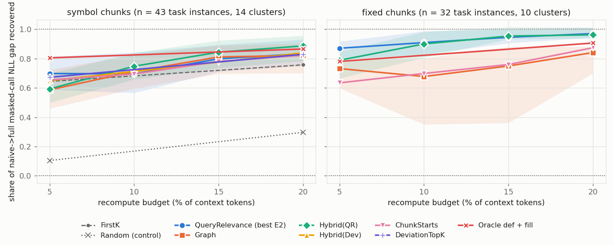
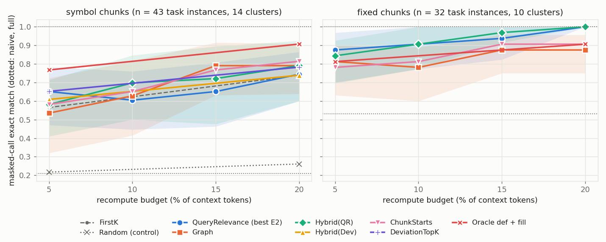

# Chunk-KV reuse on dotLLM — Phase R/P report (gate G2)

Results of the chunk-level KV reuse research up to the structure-aware selection experiment (E4), on dotLLM (CPU,
Qwen3-4B-Instruct-2507 Q4_K_M, F32 KV), for the gate G2 decision. Plan: `docs/superpowers/plans/2026-10-31-chunk-kv-reuse-phase-r-p.md`;
literature and gap verdicts: `research/landscape.md`. Every number below comes from an experiment folder with its scripts,
raw results, logs and provenance.

## Answer in brief

1. **The core hypothesis is not supported.** A reference-graph selector (Roslyn: definitions the query uses, their chunk
   starts, cross-chunk edges, imports) does **not** beat the best existing selector (ProphetKV-like query relevance) at equal
   recompute budget. With symbol chunks it is not distinguishable from it at 10–20 % (differences +0.02 to −0.01 of the
   naive→full gap; CIs admit losses up to 0.11) and is worse at 5 % and with fixed 512-token chunks (E4). Graph + query
   relevance (Hybrid) is the best runnable arm from 10 % up: both chunkers pooled 0.78 / 0.87 / 0.90 vs 0.74 / 0.83 / 0.86
   at 10 / 15 / 20 % (symbol only: 0.75 / 0.84 / 0.89 vs 0.70 / 0.80 / 0.83), within noise; on fixed chunks it is within
   about ±0.01 of query relevance.
   **Success criterion: partly met** (no detectable difference and no beat, symbol chunks only; per-cell table in
   `experiments/E4-structure-aware/README.md`).
2. **Where the graph has a signal it helps a little; mostly it has none.** Only 45 % of task instances have a query that
   references a symbol declared in a stale context chunk (0–25 % on the large repo). On those (n = 34, 8 clusters, mostly
   AFClaude, so confounded with the corpus) Hybrid − query relevance is +0.12 at 10 / 15 / 20 % with only the 15 % CI excluding
   0 (+0.12 [+0.01, +0.16]), and a significant loss at 5 % (−0.15 [−0.41, −0.02]); elsewhere the graph adds nothing. The graph
   arm's own picks are 38 % of a 5 % budget and 12 % of a 20 % budget (the rest is chunk-start fill), and these shares include
   a target-chunk-start tier that is itself chunk-start-like, so they overstate the new signal. The ceiling of the idea (an
   oracle that knows which definition the answer needs) is +0.15 of the gap over chunk starts at 5 % with symbol chunks
   (+0.15 [−0.01, +0.60], not significant, with fixed chunks) and +0.04 at 20 %.
3. **Chunk starts are the dominant, nearly free signal** (E2, E3, E4): equal prefixes of every stale chunk recover 0.65–0.82
   of the gap at 5–20 % with symbol chunks (0.63–0.87 with fixed chunks) with no model probe; CacheBlend-style layer-1
   deviation mostly rediscovers them.
4. **The 95 % / 20 % quality bar holds as a point estimate for fixed 512-token chunks** (query relevance and Hybrid: exact
   match 1.00 of full at 20 %; only 32 instances / 10 clusters, filtered to tasks full prefill solves, with naive already at
   0.53) **and not for symbol chunks** (best runnable 0.81), because symbol chunking roughly triples the stale chunk starts.
5. **Selection overhead is not the problem; recompute mechanics are.** Graph selection costs ≈ 0.1 ms (+ ≈ 1 ms lookup) with
   a prebuilt graph. On CPU the recompute path issues one `Forward` per contiguous run, so a scattered selection (query
   relevance: 188 forwards, 16 s at 20 %) costs 2.6× the wall time of the same number of mostly contiguous tokens (graph arm:
   13 forwards, 6 s — a contiguity that comes mostly from its chunk-start fill; ChunkStarts alone: 8.8 forwards, 5.8 s).
   Real speedups need single-pass recompute (dotLLM change C3), not a better selector.

## Experiments

| # | question | result (one line) | folder |
|---|---|---|---|
| E1 | full prefill vs naive concatenation vs prefix reuse | naive concat KL 0.13 / 0.17 / 0.55 / 0.67 nats at 2K/4K/8K/16K; RoPE re-rotation exact to ≤ 3e-5 of the head norm; prefix reuse exact but saves only the shared prefix | `experiments/E1-baselines` |
| E2 | baseline selectors vs budget (gate G1) | every structured selector removes about half the naive KL at 5 %; query relevance best from 10 % up (+80–97 % at 20 %); layer-1 deviation ≈ chunk starts; numeric noise floor exactly 0 | `experiments/E2-baseline-selectors` |
| corpus / tasks | 3 C# repos, cross-file masked-call tasks, Boxoffice-style validity filter | 64 kept tasks (16 / 27 / 21); reference EM 38–69 % with the definition chunk, 13–15 % without | `experiments/corpus.md` |
| graph | Roslyn reference graph | 0.25–0.41 s per 100K tokens warm; edges sparse between random context chunks (codesharp: 3 in 112 contexts) | `experiments/graph-build.md` |
| E3 | per-layer K/V deviation by token role | deviation grows with depth (×6.5–8.4 to layer 20) but is diffuse; chunk starts 3–10× the mean; definition/use sites no excess once position is controlled → E5 not run | `experiments/E3-layer-deviation` |
| **E4** | **structure-aware selection** | **graph ≈ query relevance (symbol, 10–20 %), worse at 5 % and with fixed chunks; Hybrid best but not significantly; 95/20 bar holds for fixed chunks only** | `experiments/E4-structure-aware` |

## E4: quality versus budget

<picture><source media="(prefers-color-scheme: dark)" srcset="experiments/E4-structure-aware/figures/gap-dark.png"></picture>

<picture><source media="(prefers-color-scheme: dark)" srcset="experiments/E4-structure-aware/figures/em-dark.png"></picture>

Bands: 95 % cluster-bootstrap (cluster = file of the required definition). Data: `experiments/E4-structure-aware/curves.csv`.

Share of the naive→full masked-call NLL gap recovered (ratio of means), valid instances, corpora pooled (95 % CI):

| arm | symbol 5 % | symbol 20 % | fixed 5 % | fixed 20 % | selection cost per request |
|---|---|---|---|---|---|
| ChunkStarts | 0.65 [0.50, 0.82] | 0.82 [0.71, 0.91] | 0.63 [0.26, 0.79] | 0.87 [0.76, 0.93] | ≈ 0.07 ms |
| DeviationTopK (CacheBlend-like; symbol seed 0 only) | 0.67 [0.53, 0.85] | 0.83 [0.71, 0.93] | — | — | 1.4 s probe |
| QueryRelevance (ProphetKV-like) | 0.70 [0.59, 0.81] | 0.83 [0.75, 0.93] | 0.87 [0.79, 0.92] | 0.97 [0.94, 1.01] | 16.5 s probe (lab code) |
| **Graph** | 0.59 [0.46, 0.72] | 0.82 [0.70, 0.90] | 0.73 [0.60, 0.79] | 0.84 [0.70, 0.88] | ≈ 0.1 ms (+ ≈ 1 ms lookup) |
| **Hybrid(QR)** | 0.59 [0.50, 0.70] | 0.89 [0.78, 0.96] | 0.79 [0.67, 0.85] | 0.96 [0.94, 1.01] | as QR |
| Hybrid(Dev) (symbol seed 0 only) | 0.65 [0.50, 0.80] | 0.84 [0.72, 0.93] | — | — | as Deviation |
| Random (control) | 0.10 [0.04, 0.17] | 0.30 [0.19, 0.42] | — | — | 0 |
| ORACLE definition window + chunk-start fill | 0.80 [0.66, 0.90] | 0.87 [0.75, 0.94] | 0.78 [0.71, 0.91] | 0.91 [0.85, 0.95] | not runnable |
| ORACLE whole required chunk (own budget, mean ≈ 16 %) | 0.56 [0.35, 0.74] | | 0.54 [0.31, 0.84] | | not runnable |

n = 43 instances / 14 clusters (symbol), 32 / 10 (fixed). Exact match at 20 % (full = 1.00): symbol ChunkStarts 0.81, QR 0.74,
Graph 0.79, Hybrid 0.79, oracle 0.91; fixed ChunkStarts 0.91, QR 1.00, Graph 0.88, Hybrid 1.00. Naive: 0.21 (symbol), 0.53
(fixed). Per-corpus results and paired differences: `experiments/E4-structure-aware/README.md` and `summary.md`.

## Was the success criterion met?

INCEPTION 4.5: "E4 matches or beats CacheBlend quality at the same recompute budget, or matches its quality at a lower budget,
with negligible selection overhead"; the Task 11 brief sharpens it to the best baseline.

- **Against the best baseline (query relevance): partly met.** Symbol chunks pooled: Graph is not distinguishable from it at
  10–20 % (CIs contain 0 but admit losses up to 0.11), loses at 5 %
  (−0.11 [−0.22, −0.02]); Hybrid is ahead by +0.05 at 10–20 % but not significantly. Fixed chunks: Graph is worse at every
  budget (not met); Hybrid stays within about ±0.01 of query relevance because it mostly falls back to it. Per corpus:
  AFClaude/symbol is the one cell where the graph beats query relevance (15–20 %) and also beats ChunkStarts, that cell's
  best baseline, at 15 % (+0.09 [+0.03, +0.11], 4 clusters): **met at 15 %** by the report's own rule, not at 5 %; DocAgent and
  codesharp: not met (codesharp contexts almost never contain a definition the query uses). Symbol pooled, Graph − ChunkStarts
  at 15 % is +0.03 [+0.00, +0.07]. About 40 pairwise comparisons are reported with no multiplicity adjustment, so isolated
  CIs that just clear 0 (like these) are expected by chance.
- **Against CacheBlend-like deviation (symbol, seed 0, n = 23): met in the narrow sense.** Graph is level with it at 5 % and
  20 % (−0.04 [−0.25, +0.12], +0.01 [−0.04, +0.08]) at negligible cost and
  Hybrid(QR) is ahead at 20 % (+0.07 [+0.00, +0.14]), but chunk starts also match deviation, so this does not credit the graph.
- **At a lower budget:** no graph arm at a lower budget beats a baseline at a higher one, except where the baseline's own
  curve is flat between the two budgets.
- **Overhead:** negligible (≈ 0.1 ms selection with a prebuilt graph; graph build is offline, 0.25–0.41 s per 100K tokens).

## What the graph signal adds beyond query relevance

- The query-prefix → context edges are the only structure present in these contexts: cross-chunk edges between randomly
  drawn chunks are almost absent, and E3 found no deviation excess at definition or use sites. So the graph can only point at
  definitions the query already references.
- When it can (45 % of instances; mostly AFClaude, so confounded with the corpus), its definition windows may help together
  with query relevance (Hybrid +0.12 at 10 / 15 / 20 %, CI excluding 0 only at 15 %; exact-match wins/losses 4/0 at 10 % and at
  15 %). Query relevance already attends to those definitions, so the gain is small; at 5 % the fixed 16-token windows and
  target-chunk starts crowd out better picks (−0.15 [−0.41, −0.02] in that subset).
- The masked call's own definition is usually not referenced by the prefix: an oracle that knows it gains +0.15 at 5 %, which
  bounds what query-side structure could add in this setting.
- The tokens that matter most are not in the needed chunk: re-encoding the whole required chunk recovers only 0.56 of the gap
  (0.61 without the instances whose required chunk is already exact at position 0), less than 5 % of chunk starts. Staleness is spread over every chunk boundary.

## Caveats

- **Small, clustered samples.** 75 valid instances from 26 call sites in 14 definition files; per-corpus cells have 3–6
  clusters, and some CIs are degenerate (DocAgent/fixed). The task set is the Task 8 kept set (BCL-only Roslyn resolution,
  2K contexts, one model). The pooled conclusions are the reliable ones.
- **A CPU-time subset** of the planned grid (6 / 4 / 3 / 2 contexts per corpus and cell; FirstK, Deviation, Random,
  Hybrid(Dev) at 5 / 20 % on symbol seed 0 only), chosen in a fixed order so all cells share definitions; see the E4 README "Run".
- **Seeds re-sample distractors and order around the same call sites**; they are not independent task sets. Per-context
  re-validation drops different tasks per seed and chunker.
- **Contexts are random distractors**, the hardest case for a graph. Contexts built from a dependency neighbourhood would
  carry more in-context edges; not tested (the plan's generator draws distractors at random).
- **One model** (Qwen3-4B-Instruct-2507). Llama-3.1-8B was deferred: on CPU it does not fit the time budget.
- **Recompute is one fixed token set for all layers** (no CacheBlend gradual filtering) with one `Forward` per contiguous run;
  wall times are relative CPU costs, not a serving TTFT.
- The query-attention probe is a lab implementation (scalar managed softmax over every head, layer and query row); its 16.5 s
  is not ProphetKV's real overhead.

## Recommendation for the next plan

1. **Do not build Phase S around graph-guided token selection.** Ship the simple policy: chunk-start prefixes as the static
   default, query relevance (or Hybrid) when a query is known, and fixed-size or merged-small chunks rather than raw symbol
   chunks (fewer stale boundaries). Keep `GraphSignals` as an optional, cheap add-on for code queries: from 10 % up, Hybrid is
   within about ±0.01 of query relevance on fixed chunks and +0.04–0.06 (not significant) on symbol chunks pooled, though
   individual seeds go below (symbol seed 1 at 10 %: 0.64 vs 0.70; fixed seed 1 at 20 %: 0.86 vs 0.90); avoid it at 5 %.
2. **dotLLM follow-ups first, because they decide whether reuse pays at all:** (a) **C3**, per-token query positions
   (non-contiguous rows in one `Forward`), so a scattered recompute set is one pass instead of 100–300 forwards, then measure real
   TTFT against full prefill on CPU and Vulkan; (b) a fused query-attention probe so query relevance costs milliseconds;
   (c) the Vulkan port of assembly and recompute after (a).
3. **Phase S (persistent content-addressed store, CLI, NuGet release)** once (a) shows a TTFT win: assembly, fingerprinting
   and RoPE re-rotation are proven exact (E1, E2 noise floor 0), and the 95 % / 20 % bar holds (point estimate, small sample)
   with fixed 512-token chunks and query relevance.
4. **Phase T (recurrent layers in `qwen4exp`)** does not depend on the E4 outcome: token selection does not apply to Gated DeltaNet /
   Mamba state. Landscape G4 rates recurrent-state reuse "partly covered, basic form done" (HYPIC, LinearKV), so Phase T is
   "reproduce and compare HYPIC/LinearKV on qwen4exp and add the open pieces". Run it after C3 if Phase S is the priority, or in
   parallel if the hybrid-model use case matters more.
5. If the graph idea is revisited, test it where it should be strongest: contexts assembled from a dependency neighbourhood,
   longer contexts (8K+, where E2 showed query relevance pulling away), and the definition signal used to choose **which chunks
   to include or fully re-encode**, not which tokens to recompute.