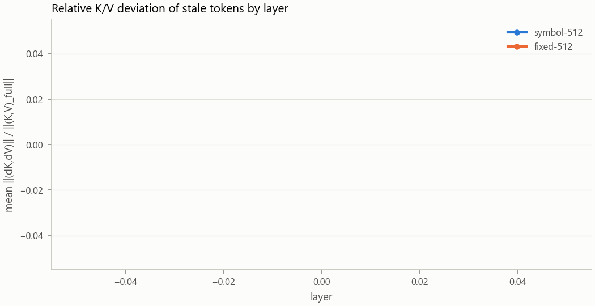
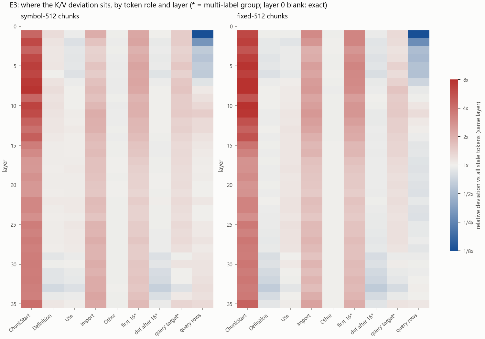
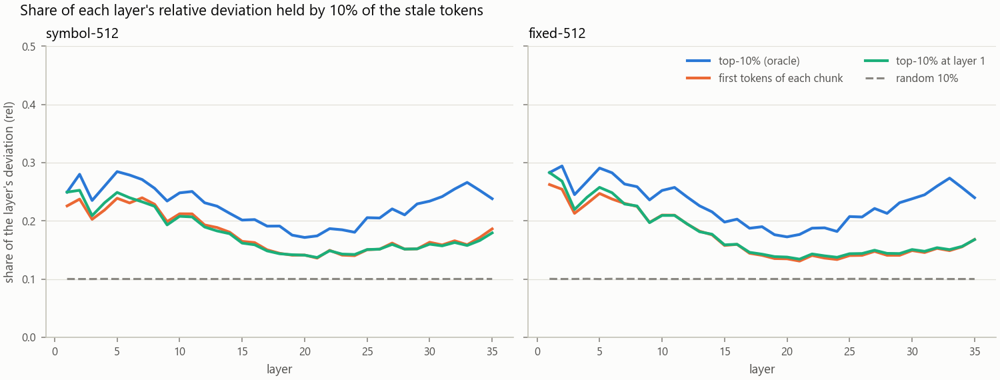

# E3 — per-layer K/V deviation of reused chunk KV, by token role (Task 10)

**Prior work, not claimed here.** Per-layer deviation profiles of reused chunk KV already exist: arXiv 2603.20218 (early-layer
CacheBlend picks sit at chunk starts; selection is layer-dynamic, 8–20 % of tokens constant across layers), CacheClip
(arXiv 2510.10129, first- vs last-layer Jaccard 0.11–0.23), SpecCache and Kamera (larger / low-rank residue in deep layers);
see `research/landscape.md` G3a. **What this experiment adds** is the breakdown by token role from a semantic (Roslyn)
reference graph — chunk start, definition site, use site, import — with a position-in-chunk control, and per-layer top-k%
capture curves against random, position-only and layer-1 baselines, on cross-file code contexts.

## Findings (177 contexts, 2K, Qwen3-4B-Instruct-2507 Q4_K_M, CPU)

Ranges below are over **layer-band averages** (bands 1 / 2–3 / 4–11 / 12–23 / 24–35, as in `summary.md`) unless stated;
per-layer extremes are given where they differ materially (`finebins.md`, generated by `finebins.py`).

<picture><source media="(prefers-color-scheme: dark)" srcset="figures/depth-dark.png"></picture>

1. **Deviation grows with depth, but it is not confined to deep layers.** Mean per-token relative deviation of stale tokens
   (symbol / fixed chunker): layer 1 0.073 / 0.053, layers 2–11 0.13–0.27 / 0.10–0.21, a peak at layers 15–24
   (0.37–0.48 / 0.34–0.45; layer 20 is the peak, 6.5× / 8.4× layer 1), then 0.26–0.37 / 0.23–0.34 at layers 25–35. Absolute ‖(ΔK,ΔV)‖ rises from 8.2 / 6.0 at layer 1 to 24–48 / 21–44
   in layers 15–35. V deviates more than K in layers 1–23 (ratio-of-sums 0.09–0.56 vs 0.05–0.47), K about as much or more in
   several late layers. Seed spread per layer ≤ 0.02 (`summary.md`, depth table). This agrees with the deep-layer findings of
   SpecCache/Kamera and is **not new**. Layer 0 is exact up to RoPE-shift float error (max per-token relative 4.0e-6); the
   first chunk is exactly 0 in every layer of every context.
2. **Per layer, deviation is diffuse across tokens.** The top 10 % of stale tokens hold only 19–28 % of a layer's deviation
   (band averages, 2–3× random; per layer 17–29 %, 1.7–2.9× random), the top 1 % hold 3–6 %, and the top 50 % hold 65–75 % (`summary.md`, concentration tables; abs and rel
   metrics agree within 0.02). Concentration is highest in layers 1–11 and lowest in layers 12–23. Seed spread of the
   top-10 % share ≤ 0.01.
3. **Position in chunk explains most of the concentration; chunk starts are the hot spot.** The first token of each chunk is
   4.4–6.2× (symbol) and 6.0–7.5× (fixed) the mean in layers 1–11 and 3.1–3.6× in layers 12–35 (band averages; per layer
   4.39–7.72× / 5.33–10.02× in layers 1–11 and 2.55–5.69× in layers 12–35); the first 16 tokens are
   2.1–3.2× early and 1.5–1.7× late. Deviation then falls with offset (offset ≥ 256: 0.43–0.87×). Simply taking the k % with
   the smallest offset in their chunk (equal chunk prefixes) captures 0.22–0.26 at k = 10 % in layers 1–11 vs 0.25–0.28 for
   the per-layer oracle top-k, and 0.15–0.16 vs 0.19–0.23 in layers 12–35 (per layer the gap reaches 0.107 symbol / 0.125 fixed at layer 33); its overlap with the oracle set is 0.55–0.74
   early and 0.32–0.41 late. **The layer-1 top-k set (CacheBlend's probe layer) captures no more than the position set at any
   depth ≥ 2** (≈ 0.01 per band mean, ≤ 0.015 per layer; at layer 1 the layer-1 set is by definition the best set): at 2K the layer-1 probe mostly rediscovers chunk starts. This matches 2603.20218's "early-layer
   picks sit at chunk starts"; the addition is that position alone matches the layer-1 set at every layer.
4. **Definition and use sites show no robust excess once position is controlled; the control is only as fine as its
   bins.** With the coarse bins of `summary.md` (offset 0 / 1–15 / 16+, all 177 contexts), DefinitionSite is 0.87–1.19× and
   UseSite 0.88–1.14× Other in the same bin; symbol definition sites after offset 16 are 1.11–1.19× in layers 1–11, as large
   as the cross-chunk 'hint' below. Deviation keeps falling with offset inside the 16+ bin, so that bin is a weak control:
   with finer bins (1–15 / 16–63 / 64–255 / 256+, `finebins.md`) on the 18 contexts whose full raw rows were kept (one per
   job), symbol DefinitionSite is 0.88–1.07× and UseSite 0.93–1.11× in the 16–63 and 64–255 bins, and the 256+ bins are
   small (17 symbol definitions: 1.04–1.36×; fixed UseSite @ 256+, n = 224: 1.12–1.30×). That sample is thin, so the
   supported statement is: no consistent definition/use excess beyond ≈ ±0.2× of Other at the same offset. The
   DefinitionSite enrichment in symbol chunks (1.1–1.3× early) is mainly position: 22 % of symbol-chunk definition sites
   lie in a chunk's first 16 tokens (`def_in_cs16`, 2.1× at layer 1) against 3 % for fixed chunks; definitions after
   offset 16 are 0.83–0.99× of all stale tokens. Other small excesses: **Import** tokens (131 symbol / 70 fixed) are 1.5–3× overall and 1.4–2.8× against
   Other at offset ≥ 16; **in-context cross-chunk edge ends** (`ctxcross`, 857 / 198 tokens) 1.1–1.4×; **query targets**
   (definition ends of query-prefix edges, 80 / 70 tokens) 1.2–1.5× in layers 1–23. All three are small-n, and the last two
   are not position-controlled; treat them as hints.
5. **Query rows** (forwarded over the stale cache) are exact at layer 0 and nearly so at layer 1 (mean relative ≤ 3e-4 per
   context: RoPE-shift float error in the context's layer-0 K, propagated), then inherit the error: 0.41–0.48×
   the stale-token mean at layers 2–3, 0.86–1.12× from layer 4 on. QuerySite rows (use ends of query-prefix edges, 112 / 108
   rows) do not differ from other query rows by more than ≈ 0.2×. The brief's "expect ≈ 0" holds only for layers 0–1.
6. **Chunker:** fixed-512 contexts deviate less on average (fewer stale chunk starts: 5–9.5 chunks per context against
   14–19 for symbol chunks), but each chunk start deviates as much or more; the profile shape is the same.
7. **Kept-task contexts vs the unfiltered sample** (symbol, seed 0, 43 vs 24 contexts, 10 shared): stale-token rel agrees
   within 0.01 per band and every role's enrichment within 5 % (ChunkStart 4.4–6.2× vs 4.5–6.4×), except Import at layers
   12–35 (1.7–1.9× vs 1.1–1.3×, n ≈ 60). The Task 8 validity filter does
   not select a different deviation regime.

<picture><source media="(prefers-color-scheme: dark)" srcset="figures/heatmap-dark.png"></picture>

<picture><source media="(prefers-color-scheme: dark)" srcset="figures/capture-dark.png"></picture>

### What this means for Task 11

- **E5 (layer-tiered recompute): do not test it in Task 11.** The plan's trigger ("if E3 pointed to depth concentration") fires
  in the weak sense: deviation grows with depth (relative deviation 6.5× symbol / 8.4× fixed from layer 1 to the layer-20 peak; 5.2× / 6.5× from
  layer 1 to the layers 12–23 average). We still recommend no: (a) Deviation is not confined to deep layers: the layers 2–11
  mean (0.17 symbol) is already about half the layers 12–35 mean (0.33–0.38), and chunk starts are most enriched there. (b) Mechanically,
  `SelectiveRecomputer` cannot refresh a token's deep-layer K/V without running that token through its shallow layers first,
  so "recompute only layers ≥ T" saves no FLOPs per token (it only leaves the freshly computed shallow K/V unwritten); the
  variant that does save FLOPs, stopping early (refresh layers < T only), would leave the largest deviation (layers 15–35)
  stale. (c) A layer-dynamic token set (CacheBlend-style gradual filtering) has little headroom over a fixed set: the
  per-layer oracle top-10 % beats the fixed layer-1 / position set by 0.03–0.08 of a layer's deviation as band averages, at
  most 0.107 (symbol) / 0.123 (fixed) at single layers (29–34), while a top-10 % set holds only 17–29 % in any layer. If E5 is
  revisited, frame it as "fewer tokens at deeper layers" at equal FLOPs, after E4.
- **For the graph selector:** deviation does not single out definition or use sites (within the resolution of finding 4), so a GraphSelector cannot be justified
  as a better deviation predictor; it has to win, if at all, through what the query needs (query targets are only mildly
  enriched, 1.2–1.5×). Chunk-start tokens remain the cheapest strong deviation signal; the HybridSelector's fill (and the
  Task 7 Combined selector) should keep them.

**Follow-up (E4, `../E4-structure-aware/`):** E5 was not run, as recommended. E4 confirmed that the graph adds little
beyond chunk starts and query relevance: Graph ≈ ChunkStarts on contexts without query targets, and a small Hybrid(QR) gain
(+0.12 of the gap at 15 %) only where the query prefix references a definition in the context.

## Caveats

- 2K contexts only (the validated size); 4K was not run (the 2K run already took 101 min against a ~90 min budget).
  Deviation and its position profile may change with more and longer stale prefixes.
- One model (Qwen3-4B-Instruct-2507 Q4_K_M), CPU, F32 KV; Llama-3.1-8B not run.
- Deviation is not quality. These are K/V distances; E2 showed quality loss concentrates at chunk starts, consistent with
  finding 3, but no output metric is computed here.
- Role groups other than chunk starts are small (Import 131 / 70 tokens; qtarget 80 / 70; QuerySite 112 / 108 rows). Their
  enrichments have wide seed spreads (`summary.md`).
- Seeds are **generator seeds** (different contexts), not repeated measurements; the CPU path is deterministic. Seed spreads
  are context-sampling spreads over the 24 first-N contexts per seed and chunker.
- codesharp symbol/seed 0 hit the per-job cap (14 min) after 20 of 25 contexts, so 16 of its 21 kept-task contexts were
  measured (43 of 48 kept-task contexts overall). The 5 dropped contexts are the **last plans in plan order**, not a random
  subset.
- Random baseline: the committed `capture.csv.gz` random column was seeded with `HashCode.Combine(plan, layer, seed)`,
  which .NET randomises per process, so that column is not bit-reproducible. Its expectation is exactly k % and the
  20-draw means sit at k % ± 0.001 in every band, so the effect is negligible; dotLLM `0c763135` replaces it with a
  deterministic mix. The column was not recomputed (it needs per-token values, kept only for 18 contexts) and no model
  run was repeated.
- Relative deviation divides by the full-prefill row norm; rows with small norms could inflate it, but the absolute metric
  gives the same top-k shares within 0.02.
- The graph is BCL-only Roslyn resolution (Task 9): third-party symbols give no edges, so some real use/definition sites are
  labelled Other.

## What was measured

For each context: the **full prefill** of the context (then the task's query prefix) on one `SimpleKvCache`, and the
**assembled** cache — every chunk encoded alone at positions 0.., placed at its context offset by `ChunkAssembler`
(K re-rotated by `RopeShift`), then the same query prefix forwarded over it. Per layer and per row: ‖ΔK‖₂ and ‖ΔV‖₂ over the
whole KV row (8 KV heads × 128), each also divided by the **full-prefill** row norm (layers differ in scale; layer 33's mean
absolute deviation is ≈ 6× layer 1's), and combined ‖(ΔK, ΔV)‖ / ‖(K, V)_full‖ ("rel", the headline metric). Code:
`KvDeviation`, `TokenRoles`, `TopKCapture` in dotLLM `src/DotLLM.ChunkReuse/Deviation/`, command `ChunkKvLab e3`
(`benchmarks/ChunkKvLab/E3Command.cs`).

- **Stale tokens** = context tokens outside the first chunk. The first chunk sees the same (empty) prefix in both arms and is
  checked to be **exactly 0** in every layer of every context (sanity table in `summary.md`). Aggregates and top-k shares are
  over stale tokens only.
- **Query rows** (the task's query prefix, masked call excluded, ≤ 256 tokens) are computed fresh in both arms, but in the
  assembled arm they attend to stale context K/V. They are therefore exact at layer 0, within 3e-4 relative at layer 1 (RoPE-shift float error), and deviate from layer 2 on
  (propagated error). The brief expected ≈ 0 for QuerySite tokens; that holds only at layers 0–1, and is reported as measured.
- **Roles** (chunk-local, from **every** edge end of the Task 9 corpus graph, not only cross-chunk edges):
  ChunkStart = offset 0 in its chunk; DefinitionSite = definition end of any edge (and both ends of a partial-declaration
  `Definition` edge); UseSite = use end of `Use`/`Call` edges; Import = either end of an `Import` edge; Other. Primary role by
  priority ChunkStart > DefinitionSite > UseSite > Import > Other. Multi-label columns: `cs1`/`cs4`/`cs16` (first 1/4/16 tokens
  of a chunk), `def`, `use`, `import`, `cross` (end of an edge whose other end is in another corpus chunk), `ctxcross` (end of
  an edge between two chunks of this context, `EdgesForContext`), `qtarget` (definition end, in the context, of an edge from
  the query prefix — beyond the brief, the set Task 11's graph selector would read), `def_in_cs16`/`def_after_cs16`.
  QuerySite = query row at the use end of a query-prefix edge (mapped by character offset into the query's own tokens).
- **ChunkStart uses k = 1** for the primary role. With k = 16 the role would swallow most symbol-chunk definitions (a symbol
  chunk starts with its declaration); the overlap is reported as `def_in_cs16`.
- **Concentration** per context and layer: share of Σ deviation over the stale tokens held by the top-k% tokens (k = 1, 5, 10,
  20, 50), against (a) a random k% (mean of 20 seeded draws; its expectation is k%), (b) **position**: the k% with the smallest
  offset in their chunk (equal chunk prefixes, i.e. the ChunkStarts selector's set), with the overlap |top ∩ position| / k,
  and (c) the **layer-1 set**: the top-k% at layer 1 (CacheBlend's probe layer) scored at every other layer.
- **Aggregation**: per-token relative deviations averaged over tokens (mean of ratios); ratio-of-sums (Σ‖ΔX‖ / Σ‖X_full‖) is
  given for K and V separately in the depth table. **Enrichment** = a group's mean rel / the mean rel of all stale tokens of the
  same contexts and layer. **Seed spread** = the cell computed per generator seed (0, 1, 2) over that seed's first-N sample
  contexts, [min, max] over the three seeds.

## Contexts and run

Contexts are Task 8 `CrossFileTaskGenerator` plans (2K tokens, ≤ 4 tasks each) of the three frozen corpora (`../corpus.md`),
regenerated by the lab with the Task 8 options and seeds. For symbol/seed 0 the regenerated plans were checked to equal
`../corpus/*.plans.jsonl` chunk by chunk before the kept flags were read from `../corpus/*.validation.csv`. Fixed-512 has no
Task 8 validation, so its contexts are unfiltered only.

| set | contexts |
|---|---|
| first 8 plans of each generator seed (0, 1, 2) × chunker (symbol, fixed) × corpus (afclaude, docagent, codesharp) | 144 |
| plus symbol/seed 0 plans holding a kept Task 8 task, beyond the first 8 | 33 (43 kept-task contexts in all; 5 codesharp kept contexts lost to the per-job time cap) |
| **total** | **177** (symbol 105, fixed 72; seed 0 / 1 / 2: 81 / 48 / 48) |

The plan's 100 contexts × 3 seeds was cut to fit the CPU budget: one context (full prefill, chunk encodings, two query
forwards, aggregation) takes 20.5–60.6 s (per-job means 26–41 s, overall mean 33 s). The run took **101.1 min** (18 jobs, `logs/`).

Provenance (every log starts with it): dotLLM `7178c597` on `feature/chunk-kv-reuse`. 17 of 18 logs record 0 dirty files;
`logs/docagent-symbol-s0-ctx2048.log` records **1**, because the Task 10 mutation script was editing
`src/DotLLM.ChunkReuse/Deviation/*` in the live worktree from 14:19:46 to 14:27:37 (it ran Debug test builds, restoring
each file afterwards). The Release binaries the run used were built by `run.ps1` at 14:19:18 from the clean `7178c597`
(before the mutation script existed) and every job runs with `--no-build`, so all results come from the clean build. The
mutation run did compete for CPU during jobs 1–2 (afclaude and docagent symbol/seed 0): their timings, not their values,
are affected; .NET SDK 10.0.401;
`bartowski/Qwen_Qwen3-4B-Instruct-2507-GGUF` @ `ae44f08e1392f39c0e474af10c3ff8355c8b6688`,
`Qwen_Qwen3-4B-Instruct-2507-Q4_K_M.gguf` (2,497,280,736 bytes); AMD Ryzen AI MAX+ 395 (16C/32T), 127 GB, Windows 11 Pro
10.0.26200; CPU only. Corpus snapshots and their chunk-id SHA-256 (enforced with `--expect-hash`): `../corpus.md`.

Reproduce: `./run.ps1 -Snapshots <dir with the t8-corpus-* snapshots> -OutDir <scratch dir>`, then
`uv run summarize.py <scratch dir>` and `uv run plot.py`.

## Files

| file | content |
|---|---|
| `run.ps1` | reproduces the run (provenance block per log, chunk-id hash enforced; raw CSVs to `-OutDir`) |
| `summarize.py` | merges the raw per-run CSVs → `contexts.csv`, `deviation-cells.csv.gz`, `capture.csv.gz`, `deviation.csv.gz`, `heatmap.csv`, `capture-curves.csv`, `summary.md` (`uv run summarize.py <OutDir>`) |
| `plot.py` | `figures/{heatmap,depth,capture}-{light,dark}.png` (`uv run plot.py`, matplotlib 3.9.2 pinned inline) |
| `contexts.csv` | one row per context: sizes, role counts, `in_sample`, `kept`, first-chunk max deviation, layer-0 max rel, seconds |
| `deviation-cells.csv.gz` | per context × layer × group (`kind` = role / label / offset / role_offset): n and sums of k_l2, v_l2, kv_l2, k_rel, v_rel, kv_rel, k_ref, v_ref, max kv_l2 |
| `capture.csv.gz` | per context × layer × metric (kv_l2, kv_rel) × k: top-k share, random, position, overlap, layer-1 set |
| `deviation.csv.gz` | **sampled raw rows**: every layer × row of two contexts (`afclaude/symbol/s0` first context, `codesharp/fixed/s0` first context), the brief's columns (`layer, context_id, seed, chunker, token_index, token_role, k_l2, v_l2, k_rel, v_rel`) plus `chunk`, `offset`, `labels`. The full raw output (≈ 7 MB per context) is not committed; aggregates are. |
| `summary.md` | every table referenced below |
| `finebins.py`, `finebins.md` | finer role-by-offset control from the 18 full raw contexts (`uv run finebins.py <OutDir>`) and the per-layer extremes behind the band averages |
| `logs/*.log` | the 18 run logs (force-added) |
