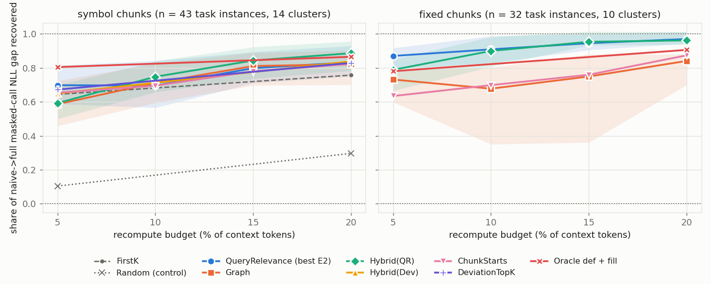
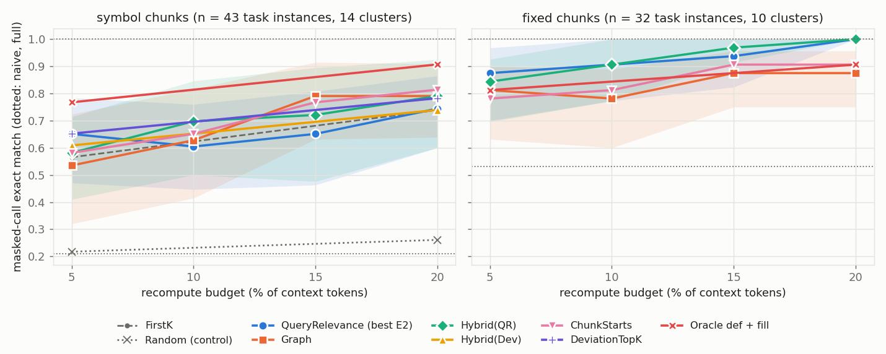

# E4 — structure-aware recompute selection (Task 11, gate G2)

**Result in brief** (Qwen3-4B-Instruct-2507 Q4_K_M, CPU, 2K contexts, 75 valid task instances from 26 call sites in
14 definition clusters; 95 % cluster-bootstrap CIs; full tables in `summary.md`):

- **The graph selector does not beat the best baseline.** With symbol chunks it is **not distinguishable from** query
  relevance (ProphetKV-like, the best E2 selector) at 10–20 % (difference in the share of the naive→full gap recovered:
  +0.02 [−0.06, +0.08], +0.01 [−0.06, +0.07], −0.01 [−0.11, +0.07]; the intervals still admit a loss of up to 0.11) and is
  **worse at 5 %** (−0.11 [−0.22, −0.02]). With fixed 512-token chunks it
  is **worse at every budget** (−0.13 to −0.23, all CIs below 0).
- **Hybrid(QR)** (graph picks, then query relevance) is the best runnable arm from 10 % up, but not significantly: +0.04 to
  +0.05 over query relevance pooled (CIs include 0; exact-match wins/losses 4/0, 5/1, 3/1) and −0.10 [−0.17, −0.03] at 5 %.
- **What the graph adds is confined to contexts where the query prefix references a symbol declared in a stale context
  chunk** (45 % of instances: 60–100 % on AFClaude, 0–25 % on codesharp). There Hybrid(QR) beats query relevance at 15 %
  (+0.12 [+0.01, +0.16], EM 4/0), and on AFClaude/symbol graph alone beats it at 15–20 % (+0.12 [+0.02, +0.16],
  +0.14 [+0.04, +0.17]) — but on AFClaude query relevance is the weakest structured selector and plain ChunkStarts is as good
  as the graph. Without such targets the graph's lower tiers (in-context edges, imports) displace chunk starts and cost
  −0.06 [−0.12, −0.00] at 5 %. **Share of the budget the graph itself chose** (the rest is chunk-start fill): 38 / 23 / 16 /
  12 % at 5 / 10 / 15 / 20 % overall; 66 / 42 / 29 / 22 % where the query has targets; 15 / 8 / 5 / 4 % (in-context edges and
  imports only) where it has none. So at ≥ 10 % most of the graph arm is fill, which is why Graph tracks ChunkStarts.
- **The idea's ceiling is real but small, and mostly at 5 %:** the ORACLE that recomputes the masked callee's 16-token
  definition window, then the same chunk-start fill, recovers 0.80 of the gap at 5 % against 0.65 for ChunkStarts
  (+0.15 [+0.03, +0.30]) and 0.73 for query relevance; at 20 % it is only +0.04 ahead. Re-encoding the whole required chunk
  (ORACLE-chunk, mean 320 tokens ≈ 16 %) recovers only 0.56, the definition window alone (≈ 14 tokens) 0.19. Without the 7
  instances whose required chunk is chunk 0 (exact under naive, so both oracles recompute nothing): 0.61 [0.45, 0.77] and
  0.21 [0.16, 0.27], and definition window + fill 0.82 vs ChunkStarts 0.65 at 5 % (set `kept-valid-reqstale`). Staleness
  elsewhere (every chunk start) matters more than the one chunk the answer needs.
- **The 95 % / 20 % bar** (exact match ≥ 0.95 × full at ≤ 20 % recompute) **holds for fixed-512 chunks** (query relevance and
  Hybrid(QR) EM 1.00 at 20 %, 0.94 / 0.97 at 15 %; n = 32) and **not for symbol chunks** (best runnable 0.81 at 20 %, ORACLE
  0.91). Pooled over chunkers: not met (best runnable 0.88).
- **Selection overhead is negligible for the graph** (median 0.1 ms selection + ≈ 1 ms graph lookup per request with a
  prebuilt graph; unit test 0.31 ms per 10K tokens), against 1.4 s for the layer-1 deviation probe and 16.5 s for this lab's
  query-attention probe (≤ 256 query rows, scalar managed code). On this run-per-`Forward` recompute path its picks are also
  contiguous: 13 forwards / 6.1 s at 20 % against 188 / 16.1 s for query relevance at the same token budget.

<picture><source media="(prefers-color-scheme: dark)" srcset="figures/gap-dark.png"></picture>

<picture><source media="(prefers-color-scheme: dark)" srcset="figures/em-dark.png"></picture>

Data: `curves.csv` (set `kept-valid|<chunker>|pooled`). Arms drawn with two points were run at 5 % and 20 % only.

### Success criterion (INCEPTION 4.5), per corpus and chunker

"Match or beat the best baseline at equal budget, or match it at a lower budget, with negligible selection overhead."
"Best baseline" in `pairs.csv` is the better of ChunkStarts and QR, the two baselines run in every cell (FirstK, Deviation
and Random ran on symbol/seed 0 only; that comparison is the `kept-valid-s0` set). It is QR almost everywhere; ChunkStarts is
as good or better on AFClaude. Differences are in gap
recovered, arm − baseline, with 95 % CIs in `pairs.csv` / `summary.md`.

| cell | n / clusters | Graph vs QR | Hybrid(QR) vs QR | verdict |
|---|---|---|---|---|
| AFClaude, symbol | 19 / 4 | worse at 5 % (−0.18); **beats QR at 15/20 %** (+0.12, +0.14, CIs > 0); ≈ ChunkStarts | worse at 5 %; +0.14 / +0.14 / +0.16 at 10–20 % (CI > 0 only at 15 %) | **partly met**: beats QR, only matches ChunkStarts |
| DocAgent, symbol | 12 / 4 | worse at every budget (−0.04 to −0.25) | = QR (±0.01) from 10 %, worse at 5 % | **not met** (Hybrid matches only through QR) |
| codesharp, symbol | 12 / 6 | ≈ QR at 5–15 %, worse at 20 % (−0.09) | identical to QR (no graph picks in most contexts) | **not met** |
| AFClaude, fixed | 15 / 3 | worse (−0.15 to −0.48) | ≈ QR from 10 % | **not met** |
| DocAgent, fixed | 9 / 3 | worse (points −0.05 to −0.11; CIs degenerate with 3 clusters) | ≈ QR | **not met** |
| codesharp, fixed | 8 / 4 | worse (−0.24 to −0.34) | = QR | **not met** |
| pooled, symbol | 43 / 14 | not distinguishable at 10–20 % (CIs ∋ 0), worse at 5 % | +0.05 at 10–20 % (n.s.), worse at 5 % | **partly met**: no detectable difference, no beat |
| pooled, fixed | 32 / 10 | worse at every budget | matches at 10–20 % | **not met** for the graph |

Against the **CacheBlend-like** layer-1 deviation selector (INCEPTION's literal wording; run on symbol/seed 0 only, n = 23,
set `kept-valid-s0|symbol|pooled` in `summary.md`), Graph is level with it (−0.04 [−0.25, +0.12] at 5 %, +0.01 [−0.04, +0.08] at 20 %) at 0.1 ms instead of a 1.4 s probe, and Hybrid(QR)
is ahead at 20 % (+0.07 [+0.00, +0.14]). ChunkStarts also matches deviation (as E2/E3 predicted), so this is not evidence for
the graph signal. **Lower budget:** no graph arm at budget b beats a baseline at a larger budget except where that baseline is
flat between the two budgets (`lower-budget.csv`); e.g. Hybrid(QR) at 15 % vs query relevance at 20 % is +0.01 [−0.06, +0.08],
but query relevance itself only moves 0.83 → 0.86 between those budgets.

### Other findings

- **Chunkers at equal budget.** Symbol contexts have ≈ 16 chunks against 5.5–8.5 for fixed 512-token chunks, so naive
  concatenation is much worse with symbol chunks (masked-call EM 0.21 vs 0.53; post-query KL 0.41 vs 0.18 nats) and every
  selector recovers less (query relevance at 20 %: 0.83 vs 0.97 of the gap). The extra chunk starts and cross-chunk edges of
  symbol chunking are not turned into quality by the graph at equal budget. (The chunkers' valid instance sets differ:
  re-validation drops different tasks.)
- **Dropping the required chunk is worse than naive reuse** (gap −1.33 [−2.39, −0.52] over the 52 instances where it ran,
  i.e. all but symbol/seed 0): stale K/V of the definition still help.
- **Seeds** (distractor sample and order around the same call sites; table "Per chunker and seed" in `summary.md`). Gap at
  20 % for QR / Graph / Hybrid(QR): symbol 0.84 /
  0.84 / 0.90 (seed 0), 0.79 / 0.83 / 0.86 (1), 0.92 / 0.76 / 0.93 (2); fixed 0.99 / 0.82 / 0.99, 0.90 / 0.79 / 0.86, 1.01 /
  0.90 / 1.00. Hybrid(QR) ≥ QR > Graph holds in every fixed seed; with symbol chunks the QR-vs-Graph order changes with the seed.
- **Sensitivity sets.** `kept-all` (no per-context re-validation, 88 instances) gives the same picture within 0.01–0.02. The
  unfiltered sample (2 contexts per corpus with every task: 15 instances, reference EM 0.20) is too weak to rank arms: at
  10 / 20 % ChunkStarts 0.54 / 0.90, QR 0.56 / 0.80, Graph 0.53 / 0.80, Hybrid(QR) 0.63 / 0.84 of the NLL gap, every arm EM 0.20.
- **Post-query KL** (32 continuation rows) agrees with the masked-call NLL. At 20 %, Hybrid(QR) / QR / ChunkStarts / Graph:
  0.043 / 0.062 / 0.074 / 0.069 nats (symbol) and 0.020 / 0.020 / 0.028 / 0.032 (fixed); naive 0.41 / 0.18.
- Exact match on one masked call is coarse (E2's caveat); the NLL gap is the primary ranking and EM is reported alongside.

## What was compared

Each **instance** is one Task 8 cross-file completion task (mask a call to a method defined in another file) evaluated in
one assembled 2K context: the required definition chunk plus seeded distractor chunks, each encoded alone and placed by
`ChunkAssembler` (RoPE-shifted K). The model then reads the task's query prefix (≤ 256 tokens of the calling file, which
ends just before the masked call) and is teacher-forced on the 32-token continuation. All arms share the context, the query
and the evaluation; they differ only in which context tokens are recomputed (`SelectiveRecomputer`, one `Forward` per
contiguous run, exact one-pass layer-wise recompute) before the query is read.

| arm | what it recomputes | runnable at serving time? |
|---|---|---|
| `full` | full prefill of the context (reference) | — |
| `naive` | nothing (naive concatenation) | yes |
| `drop_required` | full prefill of the context **without** the required chunk (the Task 8 "NC" bound; used to re-validate) | — |
| `first_k` | EPIC: 16 tokens at each stale chunk start, rest spread evenly (Task 7) | yes, static |
| `chunk_starts` | equal-length prefixes of every stale chunk (Task 7) | yes, static |
| `deviation` | CacheBlend-like layer-1 K/V deviation top-k (Task 7; probe = layers 0–1 over the context) | yes |
| `random` | seeded random stale tokens (control) | yes |
| `query` | ProphetKV-like query relevance: attention of the **task's query prefix** over the stale cache, mean over heads/rows/layers (Task 7; E2's best) | yes, per request |
| `graph` | `GraphSelector`: graph picks, then chunk-start fill (below) | yes, per request, no model |
| `hybrid_query` | `HybridSelector`: graph picks, then `query`'s ranking | yes, per request |
| `hybrid_dev` | `HybridSelector`: graph picks, then `deviation`'s ranking (the plan's original pairing) | yes |
| `oracle_def` | **ORACLE** (reads the answer): exactly the 16-token definition window of the masked callee in the context, own budget | no |
| `oracle_def_fill` | **ORACLE** definition window, then the same chunk-start fill as `graph` — the upper bound for the graph idea at equal budget | no |
| `oracle_chunk` | **ORACLE**: every token of the required chunk (re-encode it in context), own budget | no |

Budgets are `round(L × p / 100)` tokens with p ∈ {5, 10, 15, 20}, the same number of recomputed tokens for every arm
(selectors return exactly the budget; there are no contiguity expansions). Oracle arms with their own budget report their
actual token count.

### Graph picks (`GraphSignals`, dotLLM `src/DotLLM.ChunkReuse/Selectors/GraphSelector.cs`)

Built per request from the prebuilt Roslyn reference graph (Task 9), the context's chunks and the query's character range in
its file. **Only the query prefix is read**: `GraphSignals.ForTask` asks `ReferenceGraph.QueryEdges(CallSitePath,
PrefixStartOffset, MaskStartOffset)`, and the range ends where the mask begins, so the masked call (the answer) never
contributes an edge (end-to-end test with a generated task; and a test that two repos differing only in the masked call
give identical selections). In priority order:

1. **Query targets**: context tokens that are the definition end of a Use/Call/Definition edge from the query prefix, each
   with a 16-token definition window (name, parameter list; clipped to its chunk), ranked by the number of query edges into
   them.
2. **Target chunk starts**: the first 16 tokens of each chunk holding a target.
3. **In-context edges**: definition windows of edges between context chunks, by in-context in-degree, then their use tokens.
4. **Imports**: Import edge ends (query → context, then between context chunks).

Chunk 0 is exact under naive concatenation and never picked. The rest of the budget is filled in `ChunkStartsSelector`
order (offset 0 of every stale chunk, then offset 1, …), so on a context with no graph signal `graph` selects exactly what
`chunk_starts` does; every CSV row records how many of the budget's tokens were graph picks (`graph_picks`), because a
large fill can hide a null result. Query uses are not mapped into the query's own tokens: only the context side of an edge
is selected, so that mapping (the brief's suggestion) is not needed for selection.

## Instances, seeds and filtering

- **Task set**: the call sites the Task 8 validity filter kept (symbol chunker, seed 0: 16 / 27 / 21 tasks for AFClaude /
  DocAgent / codesharp). Task ids (`path:line:col`) do not depend on the seed or the chunker.
- **Contexts**: for symbol/seed 0 the Task 8 contexts themselves (regenerated and checked chunk-by-chunk against
  `../corpus/*.plans.jsonl`), restricted to their kept tasks. For every other cell `CrossFileTaskGenerator.GeneratePlansFor`
  groups the same call sites by their required chunk (chunker-specific) into contexts of up to 4 tasks and draws the
  distractors and the chunk order with the seed. **So a seed varies the distractor sample and the context order around a
  fixed set of call sites and required definitions**; with the fixed chunker the required chunk is the 512-token slice
  holding the declaration.
- **Re-validation**: a kept task is *valid* in a context when the full prefill reproduces the masked call (EM 1), the
  context without the required chunk does not (EM 0), and the masked NLL falls by ≥ ln 2 — the Task 8 filter re-applied per
  context (`drop_required` arm). The symbol/seed-0 contexts are Task 8's own, already validated (`drop_required` is not
  re-run there). Results use the valid instances (`kept-valid`); `kept-all` and an unfiltered sample are sensitivity sets.
- **Several continuations per context**: every valid task of a context is scored (1–4 per context).
- **Subset for CPU time**: see "Run".

## Metrics

- **Primary**: masked-call NLL (sum over the `MaskTokenCount` tokens from `MaskTokenOffset`) and masked-call exact match
  (every masked token is the argmax given the true prefix = greedy decoding reproduces the call).
- **Normalised** (Boxoffice-style): share of the naive→full gap recovered, as a ratio of means over instances,
  `(NLL_naive − NLL_arm) / (NLL_naive − NLL_full)` and `(EM_arm − EM_naive) / (EM_full − EM_naive)`. Values above 1 mean
  the arm scored better than full prefill on average. A ratio of means is used because per-instance ratios explode when an
  instance's naive gap is near 0.
- **Secondary**: KL(full ‖ arm) and top-1 agreement over the 32 continuation rows. All 32 rows come after the query the
  query-dependent selectors read, so this is the E4 analogue of E2's post-query rows (≥ 16); the query rows themselves are
  never scored.
- **Uncertainty**: 95 % cluster-bootstrap intervals (2000 resamples). Cluster = corpus + file of the required definition,
  so the tasks of one definition move together across contexts, seeds and chunkers (Task 8's small-n / clustered-definition
  caveat). Comparisons between arms are paired (same instances).

## Run

Job queue `jobs.csv`, driver `run.ps1` (2 jobs in parallel × 16 threads; a parallelism test gave 1.13× the throughput of
one 32-thread job). dotLLM `b03b3642` (0 dirty files in all 21 job logs), Release, CPU `TransformerModel`, F32 `SimpleKvCache`;
`bartowski/Qwen_Qwen3-4B-Instruct-2507-GGUF` @ `ae44f08e1392f39c0e474af10c3ff8355c8b6688` (Q4_K_M, 2,497,280,736 bytes); AMD
Ryzen AI MAX+ 395, Windows 11 Pro 10.0.26200, .NET SDK 10.0.401; corpora = the Task 8 snapshots (`../corpus.md`, chunk-id hash
enforced). **Total 233.8 min wall.** The `utc` line of each log's provenance block was written when the job was queued, not
when it started (`run.ps1` now writes it at start); job start times are in `logs/queue.log`.

**Subset (CPU time).** One context costs 4–9 min with every arm (full prefill 16–27 s, one evaluation ≈ 3 s per task and arm,
a scattered recompute up to 20 s with one `Forward` per contiguous run, the query probe ≈ 16 s per task), so the full grid
(≈ 290 contexts) did not fit. Contexts are taken in a seed- and chunker-independent order (hash of their first task id), so
every cell draws the same definitions first:

| cell | contexts per corpus | arms | budgets |
|---|---|---|---|
| symbol, seed 0 (Task 8's own contexts) | 6 (AFClaude 6 of 10, DocAgent 6 of 17, codesharp 6 of 21) | all; FirstK, Deviation, Random, Hybrid(Dev), Oracle-def+fill at 5/20 % only | 5/10/15/20 |
| fixed, seed 0 | 4 | drop_required, Oracle-chunk, Oracle-def, ChunkStarts, QR, Graph, Hybrid(QR); Oracle-def+fill at 5/20 % | 5/10/15/20 |
| symbol, seeds 1–2 | 3 (AFClaude seed 2: 2, time cap) | as fixed | 5/10/15/20 |
| fixed, seeds 1–2 | 2 | as fixed | 5/10/15/20 |
| unfiltered, symbol seed 0 | 2 (every task) | drop_required, ChunkStarts, QR, Graph, Hybrid(QR) | 10/20 |

So the pooled "best baseline" is chosen between ChunkStarts and query relevance at every budget (the baselines present in every
cell); FirstK, Deviation and Random are compared on symbol/seed 0 at 5 / 20 % only (`kept-valid-s0`). Identical selections are evaluated once (`memo` column: e.g. Graph = ChunkStarts on a context
without graph signal, Hybrid(QR) = QR when the graph has no picks).

**Second model (Llama-3.1-8B): deferred.** The 4B subset alone filled the ≈ 4 h CPU budget; an 8B model costs about 2× the
compute per token on CPU, so even one cell would have added 1–2 h for a handful of instances. Not run; no GPU / T5500 use
without the user.

**Tests** (dotLLM `tests/DotLLM.Tests.Unit/ChunkReuse/GraphSelectorTests.cs`, 8 tests, plus one `CorpusTests` test): written
first (build failed with CS0246/CS1061), then green; ChunkReuse suite 229/229. Mutation: 20 mutants of GraphSignals,
GraphSelector, HybridSelector and GeneratePlansFor, run in a `git archive` scratch copy (never in the live worktree while jobs
ran): 17/20 killed in round 1; the 3 survivors (chunk-0 picks, window clipping, in-context tier order) are killed by one added
test; 20/20 in round 2 (dotLLM `b99570ba`).

## Files

| file | content |
|---|---|
| `run.ps1`, `jobs.csv` | the job queue (corpus × chunker × seed × mode, arms, budgets, caps) and the driver (provenance block per log, chunk-id hash enforced) |
| `summarize.py` | merges the raw per-job CSVs → `results.csv.gz`, `curves.csv`, `pairs.csv`, `lower-budget.csv`, `overhead.csv`, `summary.md` (`uv run summarize.py <raw dir>`) |
| `plot.py` | `figures/{gap,em}-{light,dark}.png` (`uv run plot.py`) |
| `results.csv.gz` | every row: instance × arm × budget with NLL, EM, KL, top-1, budget, graph picks, forward calls, timings, memo flag |
| `curves.csv` | per set × chunker × corpus × arm × budget: gap recovered, EM, ΔNLL with CIs, KL, top-1 |
| `pairs.csv` | paired arm − baseline differences with CIs |
| `logs/*.log` | the job logs (force-added) |
