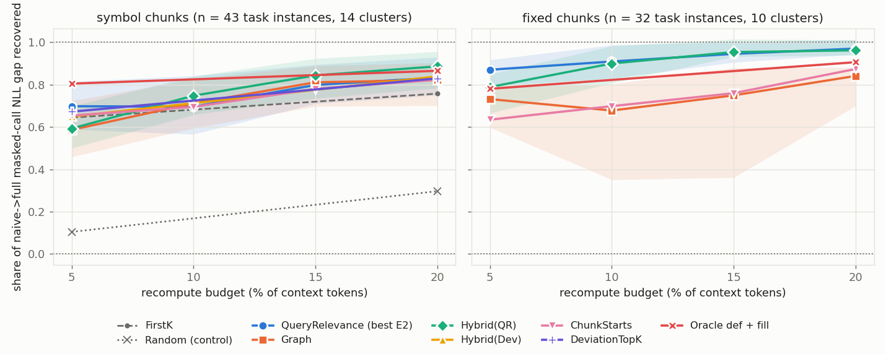

# E4b — the E4 arms on related-chunk contexts (Phase S Task 1)

**Result in brief** (Qwen3-4B-Instruct-2507 Q4_K_M, CPU, 2K contexts, 58 valid instances from 17 call sites in 12
definition clusters, 3 seeds × 2 chunkers × 3 corpora; 95 % cluster-bootstrap CIs; full tables in `summary.md`):

- **The graph selector still does not beat query relevance (QR) at equal budget.** Both chunkers pooled, share of the
  naive→full masked-call NLL gap recovered, Graph − QR: **−0.10 [−0.19, −0.05] at 5 %** (a loss), +0.06 [−0.10, +0.31] at
  10 %, +0.02 [−0.17, +0.21] at 15 %, −0.02 [−0.20, +0.09] at 20 % (not distinguishable; the intervals admit losses up to
  0.20). With fixed 512-token chunks it is worse at every budget (−0.03 to −0.09; at 20 % −0.08 [−0.35, −0.03]); with symbol
  chunks it loses at 5 % (−0.10 [−0.22, −0.03]) and is level with QR from 10 % (+0.09, +0.06, 0.00, CIs ∋ 0).
- **Hybrid(QR) (graph picks, then QR) is again the best runnable arm from 10 % up, but not significantly:** 0.87 / 0.90 / 0.94
  of the gap at 10 / 15 / 20 % against QR's 0.77 / 0.84 / 0.90 (Hybrid − QR +0.10 [−0.01, +0.34], +0.07 [−0.05, +0.23],
  +0.04 [−0.01, +0.12]; exact-match wins/losses 4/0, 4/1, 1/0), and **worse at 5 %** (−0.07 [−0.14, −0.02]). On fixed chunks
  it is within ±0.04 of QR at every budget (it mostly falls back to QR). Per seed it is not uniformly ≥ QR (related fixed
  seed 1 at 20 %: 0.96 vs 0.98; symbol seed 2: 0.94 vs 0.95).
- **Related contexts do carry more structure,** and the graph arm uses it: in-context cross-chunk edges per context 8.9 (median
  4) vs 6.1 (median 2) with symbol chunks and 5.0 (3) vs 2.1 (0) with fixed chunks; contexts without any such edge 30 % / 33 %
  vs 46 % / 58 %; valid instances whose query references a symbol declared in a stale context chunk 64 % vs 45 %; share of
  the graph arm's budget picked by the graph (not chunk-start fill) 54 / 31 / 20 / 15 % at 5 / 10 / 15 / 20 % vs 38 / 23 /
  16 / 12 %. **But the quality advantage barely moves:** on the 55 instances valid in both kinds (same task, chunker and
  seed), Hybrid − QR is +0.11 [−0.01, +0.37] / +0.09 [+0.01, +0.26] / +0.04 [−0.01, +0.13] at 10 / 15 / 20 % on related
  contexts against +0.06 / +0.04 / +0.06 on random ones, and Graph − QR +0.06 / +0.04 / +0.01 against +0.04 / +0.01 / 0.00.
  The one CI that clears 0 (matched Hybrid at 15 %) is one of about 40 unadjusted comparisons.
- **Where the graph signal helps:** only where the query has targets (n = 37, 9 clusters): Hybrid − QR +0.15 [−0.02, +0.48] at
  10 % (EM 4/0), +0.09 at 15 %, +0.06 [−0.02, +0.17] at 20 %, Graph − QR +0.12 [−0.07, +0.46] at 10 %, all n.s., and both lose
  at 5 % (−0.11 [−0.21, −0.03]). Without targets (n = 21) the graph's in-context-edge and import tiers displace chunk starts
  and cost −0.08 [−0.15, −0.04] at 10 %; Hybrid equals QR there.
- **Chunk starts are again close to the best** from 15 % (0.85 / 0.89 of the gap; the best baseline at 15 % pooled), and the
  definition-window ORACLE + fill is the ceiling at 5 % (0.84 vs ChunkStarts 0.61 and QR 0.76), +0.00 over QR at 20 %.
- **95 % / 20 % bar** (EM ≥ 0.95 × full at ≤ 20 %): fixed chunks QR and Hybrid 0.96 (met as a point estimate, 28 instances /
  10 clusters); symbol chunks best runnable 0.93 (ChunkStarts; QR 0.87, Hybrid 0.90): not met; pooled 0.93: not met.

**Answer to the task question: no.** On contexts drawn from the calling file's dependency neighbourhood, neither Graph nor
Hybrid(QR) beats query relevance at equal budget with a CI that excludes 0 in the pooled sets; Graph loses at 5 % and with
fixed chunks; Hybrid is ahead by +0.04 to +0.10 from 10 % (point estimates slightly larger than on random contexts) and
behind at 5 %. E4's conclusion stands for related contexts: the reference graph is at best a small add-on to query relevance,
not a replacement.

<picture><source media="(prefers-color-scheme: dark)" srcset="../E4-structure-aware/figures/gap-dark.png"></picture>

(The figure is E4's random-context curve, for orientation; E4b's numbers are in the tables below and in `curves.csv`, set
`related-valid|<chunker>|pooled`.)

## Why

E4 (`../E4-structure-aware`) found that the reference-graph selector does not beat QR at equal recompute budget, but its
contexts were the required definition chunk plus **random** distractors, the worst case for a graph: random chunks have
few edges between them (codesharp: none in any symbol context) and the query references a symbol in a stale chunk in only
45 % of instances. E4b repeats the core arms on contexts built from the calling file's **dependency neighbourhood**, where a
retrieval system would draw its context from and where structure-aware selection should be strongest.

## What changed against E4

Only the contexts. Same kept Task 8 call sites, same grouping into contexts (by required chunk, up to 4 tasks), same
seed- and chunker-independent context order (hash of the first task id), same arms, budgets, evaluation and statistics
(E4's `summarize.py` functions are imported, and the E4 rows in `../E4-structure-aware/results.csv.gz` are the random-context
control).

**Context builder** (dotLLM `src/DotLLM.ChunkReuse/Corpus/RelatedContextBuilder.cs`, `e4 --context-kind related
--related-fraction 0.5`):

- **Neighbourhood**: files within two hops of the calling file(s) along directed use → definition edges of the Task 9
  Roslyn reference graph (kinds Use, Call, Definition). Hop 1 = files the calling file references anywhere in its text
  **except the masked call itself** (edges whose use lies in the masked span are dropped, so the answer never chooses the
  neighbourhood); hop 2 = files the hop-1 files reference. `using` directives are **not** followed (they point at whichever
  file declares a namespace first, not at a dependency). Calling files are never part of it. For a context with several
  tasks the neighbourhood is the union over their calling files.
- **Filling**: the required chunk(s), then distractors one at a time, a related one (hop-1 files' chunks in a seeded order,
  then hop-2 files') while fewer than `0.5 × (chosen + 1)` are related, otherwise a random one from outside the
  neighbourhood; a chunk that no longer fits is skipped, and when one pool has nothing that fits, the other fills the 2K
  budget. Without exhaustion the related count is within one chunk of half the distractors. The final chunk order is a
  seeded shuffle.
- **Leak filters** (the task generator's, applied to both pools): no chunk of a calling file, no chunk declaring a member or
  type named like the callee, no chunk containing a masked call's text.
- **Re-validation in every cell** (`drop_required` in every job, including symbol/seed 0, whose Task 8 contexts are not
  reused): a task is valid in a context when full prefill reproduces the masked call, the context without the required chunk
  does not, and the masked NLL falls by ≥ ln 2.
- Seed per context = run seed × 1 000 003 + the first 28 bits of SHA-256(first task id).

In practice the hop-1 ring was large enough that hop-2 chunks were almost never drawn (related distractors per context
8.2 symbol / 3.4 fixed, of which hop 1: 8.2 / 3.4), and on AFClaude (9 files) the outside pool ran out, so its contexts are
74 % related (11.1 of 15.0 distractors, symbol) rather than 50 %.

**Arms** (as E4): `full` (reference), `naive`, `drop_required` (validity), `chunk_starts`, `query` (ProphetKV-like QR, query =
the task's ≤ 256-token prefix), `graph` (`GraphSelector`: query targets, target chunk starts, in-context edges, imports, then
chunk-start fill), `hybrid_query` (graph picks, then QR), `oracle_def_fill` (ORACLE: the masked callee's 16-token
definition window, then chunk-start fill; 5 and 20 % only). Budgets 5 / 10 / 15 / 20 % of the context, equal across arms.
FirstK, Deviation, Random and the other oracles were not rerun (E4 placed them; they are not the comparison asked for).

## Tables (pooled corpora; valid instances)

Share of the naive→full masked-call NLL gap recovered (ratio of means) [95 % cluster-bootstrap CI]:

| arm | related 5 % | 10 % | 15 % | 20 % | random (E4) 5 % | 10 % | 15 % | 20 % |
|---|---|---|---|---|---|---|---|---|
| ChunkStarts | 0.61 [0.07, 0.87] | 0.65 [0.20, 0.87] | 0.85 [0.70, 0.90] | 0.89 [0.78, 0.93] | 0.65 | 0.70 | 0.78 | 0.83 |
| QR | 0.76 [0.47, 0.91] | 0.77 [0.44, 0.94] | 0.84 [0.62, 0.96] | 0.90 [0.79, 0.98] | 0.73 | 0.74 | 0.83 | 0.86 |
| **Graph** | 0.66 [0.33, 0.84] | 0.82 [0.68, 0.89] | 0.86 [0.74, 0.91] | 0.88 [0.75, 0.92] | 0.61 | 0.71 | 0.80 | 0.83 |
| **Hybrid(QR)** | 0.69 [0.36, 0.86] | 0.87 [0.75, 0.93] | 0.90 [0.82, 0.96] | 0.94 [0.90, 0.98] | 0.63 | 0.78 | 0.87 | 0.90 |
| ORACLE def + fill | 0.84 [0.74, 0.92] | | | 0.90 [0.82, 0.95] | 0.80 | | | 0.87 |

Related: n = 58 instances / 12 clusters (symbol 30 / 11, fixed 28 / 10); random: E4's 75 / 14. The two columns are
different instance sets (re-validation keeps different tasks); the paired cross-kind comparison is the matched set below.
Naive concatenation is less harmful on related contexts: naive EM 0.53 vs 0.35 (E4 pooled), masked-call NLL 2.24 vs 3.39
nats above full prefill; full EM 1.00 by construction. A smaller gap also makes the gap ratios noisier.

Paired differences, arm − QR, gap recovered [95 % CI] (`pairs.csv`):

| set (n / clusters) | arm | 5 % | 10 % | 15 % | 20 % |
|---|---|---|---|---|---|
| related, both (58 / 12) | Graph | **−0.10 [−0.19, −0.05]** | +0.06 [−0.10, +0.31] | +0.02 [−0.17, +0.21] | −0.02 [−0.20, +0.09] |
| | Hybrid(QR) | **−0.07 [−0.14, −0.02]** | +0.10 [−0.01, +0.34] | +0.07 [−0.05, +0.23] | +0.04 [−0.01, +0.12] |
| related, symbol (30 / 11) | Graph | **−0.10 [−0.22, −0.03]** | +0.09 [−0.12, +0.35] | +0.06 [−0.17, +0.26] | +0.00 [−0.21, +0.12] |
| | Hybrid(QR) | **−0.08 [−0.17, −0.00]** | +0.13 [−0.02, +0.39] | +0.09 [−0.07, +0.27] | +0.05 [−0.01, +0.14] |
| related, fixed (28 / 10) | Graph | −0.09 [−0.23, +0.01] | −0.03 [−0.18, +0.10] | −0.08 [−0.39, +0.01] | **−0.08 [−0.35, −0.03]** |
| | Hybrid(QR) | −0.04 [−0.22, +0.07] | −0.00 [−0.03, +0.03] | −0.00 [−0.01, +0.01] | −0.01 [−0.05, +0.00] |
| related, query targets > 0 (37 / 9) | Graph | **−0.11 [−0.22, −0.03]** | +0.12 [−0.07, +0.46] | +0.05 [−0.22, +0.29] | −0.03 [−0.30, +0.13] |
| | Hybrid(QR) | **−0.11 [−0.21, −0.03]** | +0.15 [−0.02, +0.48] | +0.09 [−0.10, +0.31] | +0.06 [−0.02, +0.17] |
| related, no targets (21 / 8) | Graph | **−0.07 [−0.21, −0.00]** | **−0.08 [−0.15, −0.04]** | −0.04 [−0.15, +0.04] | −0.01 [−0.09, +0.03] |
| | Hybrid(QR) | +0.01 [−0.00, +0.05] | −0.00 [−0.02, +0.00] | +0.01 [−0.00, +0.06] | −0.00 |
| matched, related contexts (55 / 11) | Graph | **−0.09 [−0.17, −0.03]** | +0.06 [−0.10, +0.33] | +0.04 [−0.09, +0.23] | +0.01 [−0.10, +0.11] |
| | Hybrid(QR) | −0.05 [−0.12, +0.01] | +0.11 [−0.01, +0.37] | **+0.09 [+0.01, +0.26]** | +0.04 [−0.01, +0.13] |
| matched, random contexts (55 / 11) | Graph | −0.06 [−0.14, +0.04] | +0.04 [−0.04, +0.11] | +0.01 [−0.07, +0.09] | +0.00 [−0.12, +0.10] |
| | Hybrid(QR) | **−0.07 [−0.12, −0.00]** | +0.06 [−0.01, +0.15] | +0.04 [−0.01, +0.12] | +0.06 [−0.01, +0.16] |
| random (E4, 75 / 14) | Graph | **−0.12 [−0.20, −0.03]** | −0.03 [−0.09, +0.01] | −0.03 [−0.06, +0.00] | −0.03 [−0.12, +0.04] |
| | Hybrid(QR) | **−0.10 [−0.18, −0.03]** | +0.04 [−0.01, +0.11] | +0.04 [−0.00, +0.09] | +0.04 [−0.01, +0.11] |

About 40 pairwise comparisons are reported with no multiplicity adjustment, so an isolated CI that just clears 0 is
expected by chance. Against ChunkStarts (the best baseline at 15 % pooled), Graph is +0.01 [−0.02, +0.05] and Hybrid +0.05
[−0.00, +0.17] at 15 %; Graph − ChunkStarts at 10 % is +0.17 [+0.01, +0.53], driven by a weak ChunkStarts on symbol seed 1
(0.21).

Masked-call exact match at 20 % (full = 1.00): related pooled ChunkStarts 0.93, QR 0.91, Graph 0.90, Hybrid 0.93, oracle
0.90, naive 0.53; fixed QR / Hybrid 0.96; symbol ChunkStarts 0.93, QR 0.87, Graph / Hybrid 0.90. Post-query KL at 20 %
(Hybrid / QR / ChunkStarts / Graph): 0.049 / 0.052 / 0.064 / 0.065 nats.

Per seed (`summary.md`, "Per chunker and seed"): related symbol seeds 0 / 1 / 2 at 20 %, QR 0.88 / 0.82 / 0.95, Graph 0.94 /
0.87 / 0.74, Hybrid 0.89 / 0.96 / 0.94; fixed QR 0.98 / 0.98 / 0.94, Graph 0.86 / 0.87 / 1.00, Hybrid 0.98 / 0.96 / 0.94.
The QR-vs-Graph order changes with the seed on symbol chunks, as in E4.

## Validity and structure

| | related | random (E4) |
|---|---|---|
| instances run / valid | 74 / 58 (0.78) | 88 / 75 (0.85) |
| valid instances with a query target | 0.64 | 0.45 |
| in-context cross-chunk edges per context, symbol (mean, median; share with none) | 8.9, 4; 0.30 | 6.1, 2; 0.46 |
| same, fixed | 5.0, 3; 0.33 | 2.1, 0; 0.58 |
| graph share of the graph arm's budget at 5 / 10 / 15 / 20 % | 0.54 / 0.31 / 0.20 / 0.15 | 0.38 / 0.23 / 0.16 / 0.12 |
| same, instances with a query target | 0.73 / 0.42 / 0.28 / 0.21 | 0.66 / 0.42 / 0.29 / 0.22 |

Per corpus (`summary.md`, "Structure per context"): codesharp gains the most edges with fixed chunks (5.8 vs 0.1) but
symbol codesharp contexts still have none in 55 % of cases (median 0); DocAgent symbol contexts rise to 15.0 edges.

Validity drops because a neighbourhood also helps the model without the required chunk (EM without it: up to 0.29 per
cell, vs ≤ 0.44 in E4's DocAgent/fixed) and because full prefill fails more often in a crowded neighbourhood (full EM 0.50
on DocAgent symbol seed 0). The kept-valid related set is therefore selected toward instances where the neighbourhood does
not already give the answer away; it is not a random sample of "related" instances.

## Run

Job queue `jobs.csv` (one E4 random context rerun as a reproduction check, then 18 related jobs: 3 corpora × {symbol,
fixed} × seeds 0–2 with E4's per-cell context counts 6 / 4 / 3 / 2 and time caps 30 / 25 / 20 / 13 min), driver `run.ps1`
(2 jobs in parallel × 16 threads; provenance block written when each job starts; start times in `logs/queue.log`).
dotLLM `20b4da78` (0 dirty files in all 19 job logs), Release, CPU `TransformerModel`, F32 `SimpleKvCache`;
`bartowski/Qwen_Qwen3-4B-Instruct-2507-GGUF` @ `ae44f08e1392f39c0e474af10c3ff8355c8b6688` (Q4_K_M, 2,497,280,736 bytes); AMD
Ryzen AI MAX+ 395, Windows 11 Pro 10.0.26200, .NET SDK 10.0.401; corpora = the Task 8 snapshots with their chunk-id hashes
enforced (`../corpus.md`). **Total 246.2 min wall** (over the ≈ 3 h budget; the first ≈ 70 min shared the CPU with the
mutation runs, so wall times and per-arm timings from that period are inflated, and the time caps cut some cells short:
contexts run per cell are in `summary.md` "Instances", e.g. AFClaude symbol seed 0: 3 of 6).

**Reproduction check:** the random-kind rerun of E4's codesharp / fixed / seed 1 context 0 at `20b4da78` matches E4's 21 rows
exactly (max |Δ| = 0 for masked NLL, EM, KL, budget, graph picks, forward calls), so the new flag leaves the random path
unchanged and E4's rows are a valid control.

**Speed checkpoint:** this task adds no runtime path (it changes only which chunks form a context). Selection costs as in
E4: graph 0.12 ms median; recompute on the run-per-`Forward` path at 20 %: graph 14 forwards / 10.2 s, QR 184 / 26.9 s,
ChunkStarts 8 / 8.9 s (relative CPU costs, inflated by the shared CPU as above; QR's probe 20.5 s median, lab code).

**Tests** (dotLLM `tests/DotLLM.Tests.Unit/ChunkReuse/RelatedContextBuilderTests.cs`, 7 tests): written first (build failed
with CS0103 `RelatedContextBuilder`), then green; ChunkReuse suite 236/236. The plan's five tests
(`Related_RequiredChunkAlwaysIncluded`, `Related_FractionRespected_WithinOneChunk`,
`Related_NoChunkFromOutsideTwoHopsUnlessFilling`, `Related_SameSeed_SameContext`, `Related_MaskedTextNeverInContext`) plus
`Related_Neighbourhood_IsTwoHopsOfUseEdges_WithoutImportsOrTheMaskedCall` and
`Related_LeakFiltersApplied_CallingFileAndSameNameDeclarations`. Mutation: 21 mutants of `RelatedContextBuilder` (masked
edges followed, 1 / 3 hops, imports followed at hop 1 / hop 2, fraction ignored or biased, seed ignored, each leak filter
dropped, required chunk omitted, no fill, hop order reversed, calling file in its own neighbourhood, required-chunk check
dropped, no final shuffle, budget overrun, union of calling files dropped, hop distance rewritten), run in a `git archive`
scratch copy (never the live worktree while jobs ran): 17/21 killed in round 1; the 4 survivors (hop-2 imports, calling
file self-edges, unshuffled order, hop rewrite) are killed by fixture and assertion changes; 21/21 in round 2 (dotLLM
`70112a05`, applied after the jobs finished). The `e4` lab command itself has no unit test (as in E4).

## Caveats

- **Small, clustered samples**: 58 valid instances from 17 call sites in 12 definition files; per-corpus cells have 2–6
  clusters. Only pooled statements are worth reading; per-corpus tables are in `summary.md`.
- **Selection by re-validation** (above): related contexts lose 22 % of instances, not at random.
- **Hop 2 is barely exercised** (hop-1 files filled the related half), and AFClaude's contexts are ≈ 74 % related because the
  rest of that 9-file corpus is exhausted. A "neighbourhood" is a property of these three repos.
- **Same call sites, different contexts**: the cross-kind comparison pairs (task, chunker, seed) across two different
  context draws; the matched set controls for task mix, not for context length or chunk count.
- **Time caps** cut some cells below E4's context counts, so the related and random sets do not cover exactly the same
  definitions (the matched set does).
- One model, 2K contexts, one fixed token set for all layers, one `Forward` per contiguous run (as E4).

## Files

| file | content |
|---|---|
| `run.ps1`, `jobs.csv` | job queue and driver (provenance block per log, chunk-id hash enforced) |
| `summarize.py` | merges the raw E4b CSVs with E4's `results.csv.gz` → `results.csv.gz`, `curves.csv`, `pairs.csv`, `contexts.csv`, `summary.md` (`uv run summarize.py <raw dir>`) |
| `results.csv.gz` | every row (related E4b rows + E4 random kept rows), with `context_kind`, `related_chunks`, `hop1_chunks` |
| `curves.csv`, `pairs.csv` | per set × chunker × corpus × arm × budget curves; paired differences with CIs |
| `contexts.csv` | one row per context: chunks, related / hop-1 distractors, in-context edges, query targets, valid tasks |
| `logs/*.log` | job logs (force-added) and `queue.log` |
